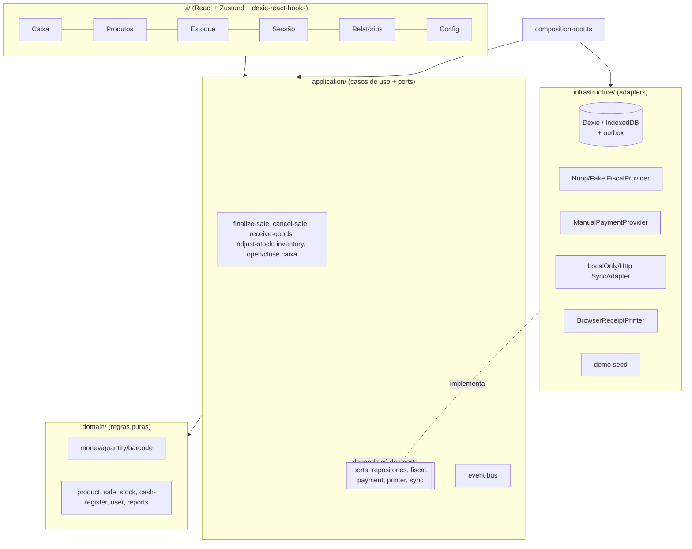
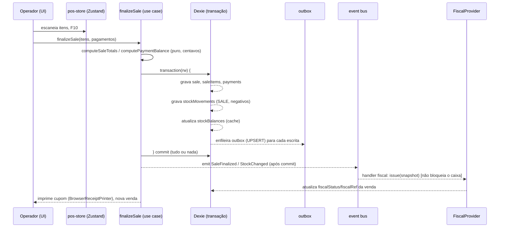

# Arquitetura

O app segue **Ports & Adapters** (arquitetura hexagonal). O domínio e os casos de
uso são puros (sem React, sem Dexie). A infraestrutura implementa as _ports_ e é
escolhida em um único lugar: `src/composition-root.ts`.

## Camadas

**Regras de dependência:**

- `domain/` não importa React, Dexie, nem `application/` ou `infrastructure/`.
- `application/` depende apenas de `domain/` e das suas próprias _ports_.
- `infrastructure/` implementa as _ports_; é fiada em `composition-root.ts`.
- `ui/` consome o `AppContainer` via contexto React.

## Fluxo de uma venda (finalize-sale)

Pontos-chave:

- **Atomicidade:** venda + itens + pagamentos + movimentos + outbox são gravados
  na mesma transação Dexie. Se qualquer passo falha, nada é persistido
  (provado em `finalize-sale.test.ts`).
- **A rede nunca está no caminho crítico.** O fiscal e o sync reagem a eventos
  _após_ a venda já estar finalizada localmente.
- **Estoque é ledger.** O saldo é sempre recalculável a partir dos movimentos
  (`rebuildBalances`); vendas/movimentos são append-only e nunca conflitam no sync.

## Modelo de dados (resumo)

`products`, `categories`, `stockMovements` (ledger), `stockBalances` (cache),
`sales`, `saleItems`, `payments`, `cashSessions`, `cashMovements`, `users`,
`settings`, `outbox`, `auditLog`. Migrações versionadas do Dexie desde a v1
(`infrastructure/db/schema.ts`). Convenções: dinheiro em centavos inteiros,
quantidade em milésimos, toda entidade com `id` (UUIDv7), `createdAt`,
`updatedAt`, `deletedAt?`, `version`.
